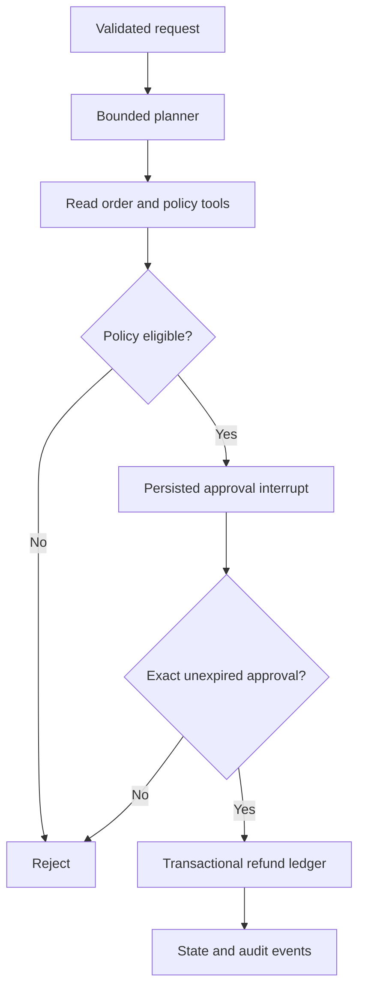

# Approval Ops Agent
A Python, FastAPI and LangGraph reference workflow for customer-support refund exceptions. An agent reads an order and return policy, creates a proposal, pauses for human approval, and records a simulated refund exactly once in a transactional ledger.

**Synthetic orders and a local ledger only. No bank, commerce account or external refund is contacted.** This is a portfolio reference implementation, not a claim of production deployment.

## Quick start (Python 3.12)
```bash
uv sync --frozen --extra dev
export API_TOKEN="$(python -c 'import secrets; print(secrets.token_urlsafe(32))')"
uv run uvicorn app.api:app --host 127.0.0.1
```
Use `/docs` with your bearer token or:
```bash
curl -H "Authorization: Bearer $API_TOKEN" -H 'Content-Type: application/json' localhost:8000/runs -d '{"order_id":"ORD-100","requested_cents":1000,"note":"Returned item"}'
```
Copy the returned `run_id` and `state.proposal_hash`. Review the proposal amount and order, then POST `/runs/{run_id}/decision` with `{"approved":true,"proposal_hash":"<exact hash>"}`. GET `/runs/{run_id}` returns state and step events. Approval expires after 15 minutes. `ORD-200` is outside the return window; `ORD-300` is not returned.

```bash
uv run pytest -q
API_TOKEN="$API_TOKEN" docker compose up --build
```
## Agent behavior
The offline planner emits actual structured tool calls through LangChain tools inside LangGraph. `USE_OLLAMA=true uv run uvicorn app.api:app` enables model-generated tool calls using an existing local Ollama `qwen3:4b`. Tool names and exact order arguments are allowlisted. The model can inspect only; it cannot approve or execute. Malformed/incomplete plans fail closed. No claim is made that the offline planner demonstrates LLM reasoning. Model-dependent behavior needs live validation with your installed weights.

Transient network/timeouts get at most three planner attempts with bounded backoff. Invalid plans and HTTP status failures are not retried. Tool calls are bounded to two reads and graph execution has a recursion cap. There is no open-ended agent loop.

## State and effect guarantees
LangGraph SQLite checkpoints persist interruptions across restart. A separate ledger records the decision hash and approved flag; execution rechecks policy and expiry. A unique order key blocks duplicate refunds across runs; exact-run replay returns the existing effect. API decisions are serialized by a process lock; deploy **one worker only**. Durable audit events expose step names/times and a run ID without logging customer notes or model content.

The approval endpoint authenticates using the same operator token as other endpoints. Separate approver roles, tenant isolation, multi-worker concurrency control, event export/metrics and external payment reconciliation are future deployment requirements. This is not four-eyes authorization. Checkpoints and ledger writes are separate transactions: a crash between decision persistence and checkpoint persistence needs operator reconciliation; a crash after a refund effect can safely replay the same ledger entry, but external payment adapters require provider idempotency and outcome reconciliation. Never blindly retry an uncertain external effect.

## Trade-offs
- SQLite makes a local demo reproducible; PostgreSQL checkpoints, row locks and an outbox suit multi-worker operations.
- Deterministic business policy owns amounts and eligibility. A model can select tools but never broaden permissions.
- Proposal hashes bind approval to immutable details. Approval expiry and policy are checked again at execution.
- A synthetic ledger permits repeatable tests without real financial operations.


See `VERIFICATION.md` for executed tests and remaining limits.
